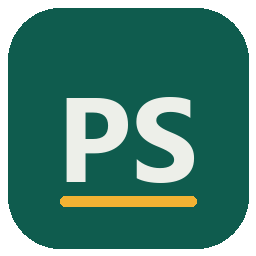
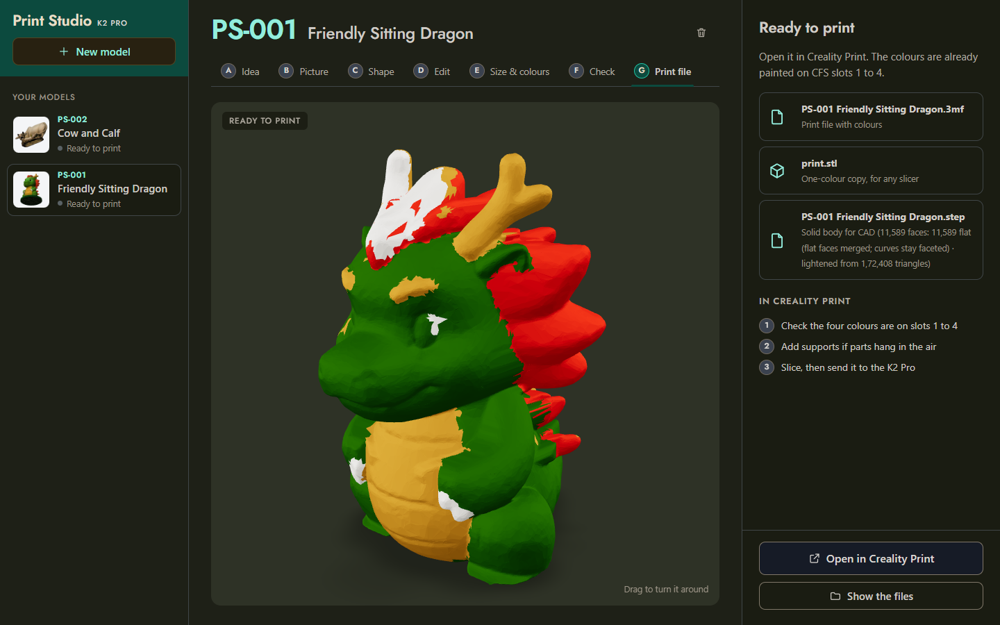
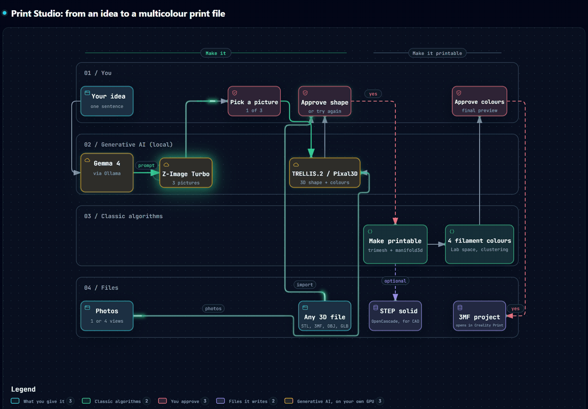
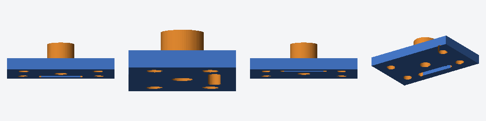

<p align="center">
  
</p>

<h1 align="center">Print Studio</h1>

<p align="center">
  <b>Words, photos or any 3D file → a multicolour print file, ready for the slicer.</b><br>
  A local desktop app for Windows. Everything runs on your own graphics card: no account, no cloud, no fees.
</p>

<p align="center">
  <a href="../../releases/latest"><b>Download the installer</b></a> ·
  <a href="#how-it-works">How it works</a> ·
  <a href="#install">Install</a> ·
  <a href="docs/">Design notes</a>
</p>

<p align="center"></p>

## What it does

Type *"a friendly cartoon dragon sitting down, green with a yellow belly"* and a few minutes later you get a
Creality Print project with the dragon already painted in your four filament colours, on the right CFS slots.

- **From words**: the idea helper writes a printable prompt, Z-Image Turbo draws three options, you pick one.
- **From photos**: one photo, or four (front, right, back, left) for much better sides and back.
- **From a 3D file**: STL, 3MF, OBJ, GLB or PLY. A painted 3MF keeps its colours.
- **3D shape and colours** with TRELLIS.2 (one picture) or Pixal3D (four pictures).
- **Edit the model**: select parts to remove, keep or resize, cut flat below a line, and repaint areas.
- **Made printable**: one closed solid, cut flat on the bed, scaled to your height, with checks for thin
  parts and fit, and an estimate of filament grams.
- **Colours mapped to your filaments**: the model's colours become your 4 loaded filaments, painted per
  triangle in the slicer's own colour-painting format, so the slicer opens it with the colours already set.
- **Solid files for CAD**: convert meshes (many at once) into STEP solid bodies for Fusion, SolidWorks,
  FreeCAD or Onshape. Flat faces and holes are rebuilt as true planes and cylinders.

<p align="center"><br>
<sub>From words: three pictures to choose from…</sub></p>
<p align="center"><br>
<sub>…the 3D model painted in the four loaded filaments, from all sides.</sub></p>

## Install

**You need:** Windows 10 or 11, an NVIDIA RTX graphics card with 8 GB or more (RTX 3070 or better is
comfortable), 32 GB of RAM, and about 60 GB of free disk space.

> **Windows only for now.** The 3D models need an NVIDIA graphics card (CUDA), so Macs, AMD and Intel
> graphics cards aren't supported, and there's no macOS or Linux installer yet.

1. Download **PrintStudio-Setup.exe** from the [latest release](../../releases/latest) and run it.
2. Pick a folder on a drive with space. Leave *Idea helper* ticked unless you want to skip the 8 GB language model.
3. A console window installs everything. It takes 30–90 minutes the first time, mostly downloading AI models:
   - Python 3.11, if you don't have it (installed for your user only);
   - the app;
   - the 3D engine ([WanGP](https://github.com/deepbeepmeep/Wan2GP)) with PyTorch and CUDA;
   - [Ollama](https://ollama.com) and Gemma, for the idea helper (optional);
   - the AI models (~35 GB). Each 3D step then runs once on a test picture, so you know your graphics card
     works before you start.
4. Open **Print Studio** from the desktop or the Start menu.

If the internet drops or you close the window, run setup again. It continues where it stopped.

<details>
<summary><b>Install from the source code instead</b></summary>

```bat
git clone https://github.com/Soham-Rangdal/print-studio-ai.git
cd print-studio-ai
setup.bat
```

Options:

| | |
|---|---|
| `setup.bat -NoLLM` | Skip the idea helper. Ideas are then used as written. |
| `setup.bat -WanGPDir D:\Wan2GP` | Use a WanGP you already have, with its models, instead of installing another. |
| `setup.bat -SkipModels` | Don't download models now. Each one downloads the first time it's needed. |

</details>

<details>
<summary><b>If setup stops</b></summary>

- **"Read timed out" or "No matching distribution found"**: a download site (usually pypi.org) didn't
  answer. Wait a while, or try another network, then run `setup.bat` in the install folder. Finished steps
  are skipped.
- **"No NVIDIA graphics card found"**: install or update the NVIDIA driver, then run setup again.
- **Anything else**: everything setup printed is in `install.log` in the install folder. Please attach it
  when you [open an issue](../../issues).

</details>

## How it works

<p align="center"><br>
<sub>Amber: generative AI on your own GPU. Green: classic algorithms. Red: you approve.</sub></p>

- **One model on the graphics card at a time.** The 3D engine runs in its own process. The language model
  is unloaded straight after each answer, so everything fits in 8 GB of VRAM.
- **Every project is a folder** (`jobs/<id>/`) with its state in `job.json`. Close the app at any time and
  it carries on when you reopen it. A failed step reruns on its own.
- **Colour by painting, not by cutting.** The 3MF holds one solid mesh with a filament number on each
  triangle, so the slicer builds the colour volumes itself and nothing comes apart.
- **Exact steps are plain code.** Geometry, scaling, colour mapping and file writing are
  numpy / trimesh / manifold3d / OpenCascade. AI is used only for pictures, shapes and the prompt.

| Part | Built with |
|---|---|
| App window | FastAPI + pywebview, plain HTML/CSS/JS, three.js and model-viewer |
| Pictures, 3D shapes, colours | [WanGP](https://github.com/deepbeepmeep/Wan2GP): Z-Image Turbo, TRELLIS.2, Pixal3D |
| Idea helper | Gemma 4 12B through [Ollama](https://ollama.com) |
| Mesh repair and printing checks | trimesh, manifold3d, scipy, scikit-learn, fast-simplification |
| STEP solids | OpenCascade (cadquery-ocp) |

<p align="center"><br>
<sub>A mesh bracket rebuilt as a solid: 2,028 triangles become 9 planes (blue) and 8 cylinders (orange).</sub></p>

## Printer

Made for and tested with a **Creality K2 Pro with one CFS** (4 filaments) and **Creality Print 7.3**. The
printer, nozzle and filament settings come from a template project (`templates/k2pro_template.3mf`).
Another printer that uses an OrcaSlicer-based slicer (Creality Print, OrcaSlicer, Bambu Studio) should work
if you save a project from your slicer as the template. That hasn't been tested yet.

## Project layout

```
app/          desktop window, local server, the step-by-step pipeline, the UI (static/)
tools/        mesh import, repair and printability, colours, editor, 3MF writer, STEP converter
worker/       the 3D engine worker (one WanGP session, JSON over stdin/stdout)
installer/    setup script, model download, Setup.exe recipe (Inno Setup)
templates/    the slicer project the 3MF files are based on
docs/         design notes and test results for each part
```

## License

Print Studio's code is under the [MIT license](LICENSE). The 3D engine and the AI models are not part of this
repository. Setup downloads them from their official sources, and each keeps its own license: WanGP
(WanGP Community License: free to use, but not to sell or embed in a paid product), Z-Image Turbo,
TRELLIS.2 and Pixal3D (see their model pages), and Gemma (Gemma Terms of Use).
